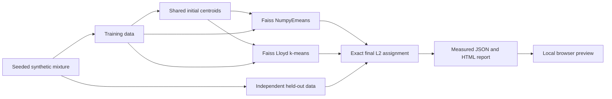

# e-means clustering benchmark

Run native Faiss e-means on CPU, assign new vectors, and compare it with Lloyd's k-means using the same synthetic training data and initial centroids. A self-contained HTML report shows final clustering loss, held-out loss, measured runtime and a two-coordinate projection. This makes it easy to inspect what frequent mini-batch updates change before clustering embeddings for retrieval, quantization or data curation.

The project calls [`NumpyEmeans` from Faiss](https://github.com/facebookresearch/faiss/tree/main/contrib/e_means) directly. It does not implement an approximation of that algorithm. Upstream also provides GPU backends; this project runs CPU only.

## Run

Python 3.10+ is required; the pinned Windows packages were tested with Python 3.13. Create an environment outside the project directory if you want to keep the source tree free of generated files:

```powershell
python -m venv $env:TEMP\emeans-env
& $env:TEMP\emeans-env\Scripts\python.exe -m pip install -r requirements.txt
& $env:TEMP\emeans-env\Scripts\python.exe -B benchmark.py --serve
```

Open http://127.0.0.1:8881/ and keep the command running. Stop it with Ctrl+C. The server binds only to the loopback interface and serves the generated output directory. `artifacts/index.html` can also be opened directly. `artifacts/results.json` contains the measured numbers and the resolved native training recipe.

On Linux/macOS, use the virtual environment's `bin/python` executable. No API key, downloaded dataset, model weights or network connection is needed after installing dependencies.

### Native CPU quickstart

```powershell
python -B quickstart.py
# Smaller smoke run:
python -B quickstart.py --samples 2000 --new-samples 500 --dimension 8 --clusters 10
```

The default matches this complete native flow, with seeded input generation for repeatability:

```python
import numpy as np
from faiss.contrib.e_means import NumpyEmeans

rng = np.random.default_rng(7)
x = rng.random((200_000, 64), dtype="float32")
em = NumpyEmeans(64, 500, seed=7)
centroids, labels = em.train(x)
x_new = rng.random((100_000, 64), dtype="float32")
distances, new_labels = em.assign(x_new)
```

`distances` are squared L2 distances. Training returns last-pass labels collected as the centers move. Those labels can differ from assignments to the final centroids. Call `em.assign(x)` for exact final labels; the comparison report performs an independent exact assignment for both models.

### Change the comparison

```powershell
python -B benchmark.py --samples 20000 --dimension 32 --clusters 32 --epochs 2.5 --lloyd-epochs 25 --seed 11 --threads 1 --output artifacts
python -B -m unittest -v
```

`--epochs` accepts finite values of at least 1, including fractional passes. `--lloyd-epochs` is an integer. Both algorithms see all rows, with no training subsampling, and start from an identical sampled centroid array. Native e-means selects its batch size and initial EMA step through its own scaling rules. Faiss can revive underused clusters during training. The report records the actual recipe and revival count.

## Code map

| File | Responsibility and connection |
| --- | --- |
| `quickstart.py` | Generates uniform FP32 vectors, runs the native `train`/`assign` example and prints resulting array shapes. |
| `benchmark.py` | Validates CLI inputs, generates deterministic mixture/held-out data, trains both native models, evaluates final centers with one exact L2 metric, writes results and optionally starts the local report server. |
| `report.py` | Converts the measured results and projected points into a portable HTML report with inline SVG. It needs no browser JavaScript or external assets. |
| `test_benchmark.py` | Exercises actual Faiss training, deterministic starts, fractional budgets, input rejection and JSON/HTML outputs; checks the final metric against a separate NumPy distance oracle. |
| `requirements.txt` | Pins the native CPU engine and NumPy. |
| `.gitignore` | Excludes environments, caches, arrays and generated reports. |



## Interpreting the results

This is a small CPU experiment on synthetic data, with a single seed and one timed run per method. The algorithms use different pass budgets, displayed in the report. Timing excludes data generation and includes each native training call; final training/held-out evaluation is timed separately. There is no warm-up or statistical runtime analysis, so measured times are illustrative. No conclusion about published GPU speedups or large embedding datasets follows from this run.

The displayed loss is the mean squared L2 distance to final centroids across all dimensions. Internal moving-pass objectives are deliberately not compared as final loss. The scatterplots share coordinate bounds and show only the first two coordinates, so they can hide structure in other dimensions. Defaults use one Faiss CPU thread and deterministic seeds; exact reproducibility across hardware/library builds is not guaranteed.

The pinned Faiss release implements the public API inspected here. Consult the [upstream e-means documentation](https://github.com/facebookresearch/faiss/tree/main/contrib/e_means) and [benchmark tools](https://github.com/facebookresearch/faiss/tree/main/benchs/e_means) for large-scale or GPU experiments. A run on real embeddings should use a representative dataset and repeated seeds before choosing an algorithm.
